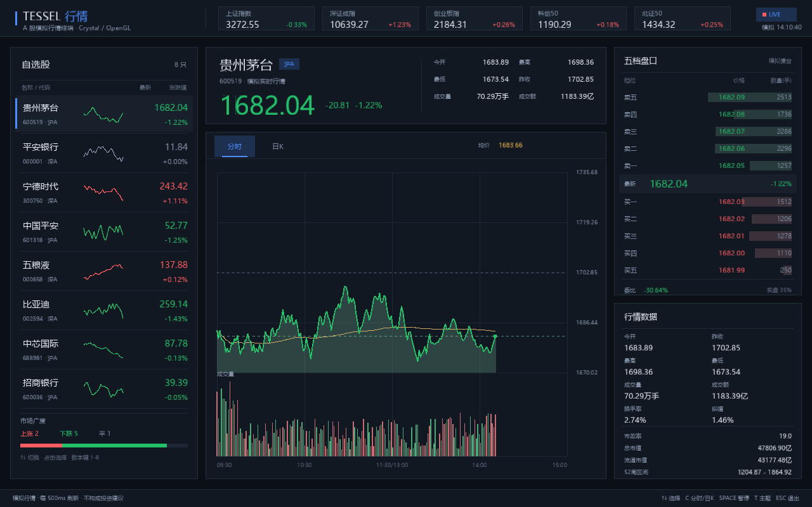
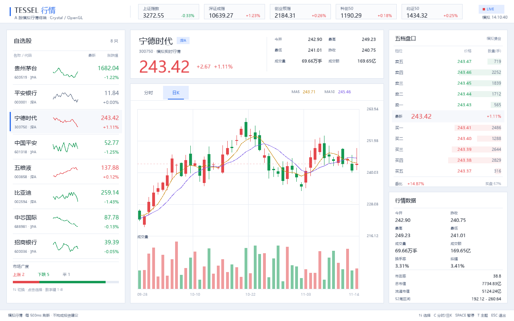

# Tessell Stock Demo

用 [Tessell](https://github.com/ShiningRay/tessell)（Crystal retained-mode 自绘 GUI 框架）实现的 A 股行情终端 Demo。
纯 FFI + OpenGL 自绘，不依赖 Qt / WebView / 原生控件；全部行情为本地可复现的模拟数据。





## 功能

- **自选列表**：8 只 A 股，价格 / 涨跌幅 / 迷你走势，鼠标点击或 `↑` `↓` / 数字键 1–8 切换。
- **分时图**：240 分钟坐标、均价线、昨收/现价参考线、面积填充、分钟成交量。
- **日 K**：48 根可见日线、MA5 / MA10、涨跌配色、成交量；`C` / `K` 或点击页签切换。
- **五档盘口**：买卖五档、价差、委托量深度条、委比 / 买盘占比。
- **行情数据面板**：开高低收、成交量额、换手率、振幅、市盈率、市值、52 周区间。
- **主题与暂停**：深色 / 浅色实时切换（`T`），暂停 / 继续（`SPACE`）。
- **确定性模拟**：固定 seed 下价格、成交量、盘口与截图完全可复现，方便回归测试。
- **截图自动化**：`--frames` + `--screenshot` 输出 TSRAW，配套 PNG 转换脚本。

## 快速开始

环境与 Tessell 一致：**Windows + msys2 ucrt64 + Crystal 1.22**。

`shard.yml` 直接引用公开的 Tessell 仓：

```yaml
dependencies:
  tessell:
    github: ShiningRay/tessell
    branch: main
```

`shards install` 会拉取 Tessell 到 `lib/tessell`；若本机正在并行修改 Tessell，
可临时把依赖改成 `path: ../tessell` 做本地联调。

构建与运行：

```powershell
$env:PATH="C:\msys64\ucrt64\bin;$env:PATH"
shards install
crystal build src/stock_demo.cr -o bin/stock_demo.exe
bin/stock_demo.exe
```

字体：默认读取 `C:/Windows/Fonts/msyh.ttc`，可用 `--font=PATH` 覆盖。
运行时 DLL 需要 `C:\msys64\ucrt64\bin` 在 `PATH` 中（FreeType / HarfBuzz / Boehm GC 等）；
缺少 DLL 时进程可能以 `-1073741515`（0xC0000135）退出。

## 操作

| 操作 | 功能 |
|---|---|
| `↑` / `↓` | 上一只 / 下一只自选股 |
| `1`–`8` | 直接选择自选股 |
| 鼠标点击自选行 | 选择股票 |
| `C` / `K` | 分时 / 日 K 切换 |
| 点击「分时」「日K」页签 | 同上 |
| `SPACE` | 暂停 / 继续模拟行情 |
| `T` | 深色 / 浅色主题 |
| `ESC` | 退出 |

## 命令行

```text
--theme=dark|light      启动主题（默认 dark）
--tick-ms=N             模拟行情刷新间隔，毫秒（默认 500）
--warmup=N              启动前预演 N 个 tick（默认 0）
--seed=N                模拟随机种子（默认 20261114）
--font=PATH             字体文件
--frames=N              只渲染 N 帧后退出（用于截图 / 自动化）
--screenshot=PATH       退出前保存 TSRAW 截图
--view=intraday|daily   启动图表视图
--select=N              启动时选中第 N 只自选股（0 起）
--fps=N                 交互帧率上限（默认 60）
--help                  帮助
```

示例：生成 README 里的截图。

```powershell
bin/stock_demo.exe --frames=2 --warmup=40 --screenshot=docs/screenshot-dark.tsraw
uv run --with pillow python tools/tsraw_to_png.py docs/screenshot-dark.tsraw docs/screenshot.png

bin/stock_demo.exe --frames=2 --warmup=40 --theme=light --view=daily --select=2 `
  --screenshot=docs/screenshot-light.tsraw
uv run --with pillow python tools/tsraw_to_png.py docs/screenshot-light.tsraw docs/screenshot-light.png
```

## 架构

| 文件 | 职责 |
|---|---|
| `src/stock_demo/market.cr` | 确定性行情引擎：股票、指数、OHLC、分时、日 K、五档盘口、涨跌停约束 |
| `src/stock_demo/layout.cr` | 1280×800 固定布局，所有面板 / 行 / 图表区域与命中矩形 |
| `src/stock_demo/theme.cr` | 深色 / 浅色调色板（RGBA，红涨绿跌） |
| `src/stock_demo/painter.cr` | 批量四边形绘制：面板、网格、成交量、K 线、折线、面积填充 |
| `src/stock_demo/text_layer.cr` | Tessell TextRenderer 之上的字宽缓存与左/右/居中对齐 |
| `src/stock_demo/app.cr` | 状态、Tessell UI DSL 命中树、布局组合、输入与逐帧渲染 |
| `src/stock_demo/win32.cr` | Win32 窗口 + WGL 上下文 + 消息循环（纯 FFI） |
| `src/stock_demo/shot.cr` | 读取 OpenGL 前缓冲，写出 TSRAW |
| `tools/tsraw_to_png.py` | TSRAW → PNG（Pillow，按需安装） |
| `tools/gate.ps1` | spec + build + 截图 smoke 的一键门禁 |

### 帧流程

每帧：

```text
Win32 messages
  -> App#run_frame
       -> 模拟 tick（按时间 / pause）
       -> UI.build -> UI.apply（retained 命中树）
       -> Painter 收集矩形/线段/面积列
       -> TextLayer 生成文本四边形（glyph atlas + shaped-run cache）
       -> GLBackend.begin_frame(theme)
       -> Painter 一次性 glBegin(GL_QUADS) 提交自绘图形
       -> GLBackend.draw_text 提交文本
       -> GLBackend.end_frame
  -> SwapBuffers
```

- 视觉与布局由 `Layout` 统一给出，DSL 节点只负责命中测试（自选行、图表页签），
  因此绘制路径与交互路径共享同一组坐标。
- 每帧全量重绘；Tessell 的脏矩形机制保留给后续优化，本 Demo 优先保证实现简单可读。
- 文本使用 Tessell 的 shaped-run cache；新字形进入 atlas 后按
  `page_count / used_pixels / evicted_total` 变化增量重传纹理
  （只比较页数会漏掉已有页内的新字形，这是本 Demo 踩过的坑）。

### 数据源替换

`Market` 是普通 Crystal 类，外部只需要 `stocks`、`indices`、`minute`、`tick` 等表面。
接入真实行情时，替换 `Market` 的生成逻辑即可；UI 与渲染层不依赖数据来源。
当前没有任何网络请求，也不会下单。

## 验证

```powershell
$env:PATH="C:\msys64\ucrt64\bin;$env:PATH"
crystal spec
```

当前：**13 examples / 0 failures**。覆盖：

- 相同 seed 的确定性；
- OHLC / 涨跌停 / 分时点数 / 盘口排序不变量；
- 涨跌幅、振幅、成交量与百分比格式化；
- 三栏布局、行命中矩形、图表页签边界。

一键门禁（spec + 构建 + 2 帧截图 smoke）：

```powershell
powershell -NoProfile -ExecutionPolicy Bypass -File tools/gate.ps1
```

## 已知限制

- 仅 Windows：Tessell 当前 WGL 后端为 Windows 验证范围，macOS / Linux 未接入。
- 窗口固定 1280×800，未实现缩放 / 高 DPI 布局 / 多显示器处理。
- 单一字体文件（默认微软雅黑），无字体回退与粗体字重。
- 行情完全模拟：无网络、无持久化、无账户与交易能力；数字不代表任何真实标的。
- 每帧全量重绘；文本 atlas 内容同步由 Demo 自行检测，框架层尚无 dirty atlas API。
- 本 Demo 用于展示 Tessell 的 retained 树、文本栈、自绘与 Win32/GL 集成，不是生产行情软件；
  不构成投资建议。

## License

MIT，见 [LICENSE](LICENSE)。Copyright (c) 2026 ShiningRay。
